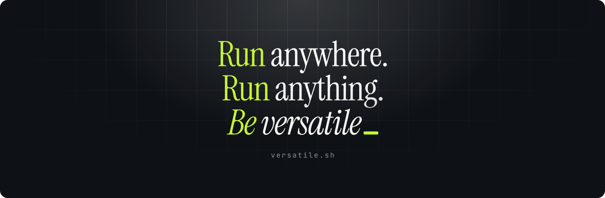
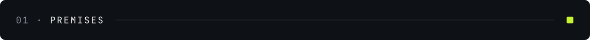
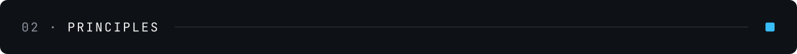
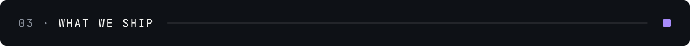

<a href="https://versatile.sh">
  <picture>
    <source media="(prefers-color-scheme: light)" srcset="./assets/banner-light.svg">
    
  </picture>
</a>

  <picture>
    <source media="(prefers-color-scheme: light)" srcset="./assets/logo-light.svg">
    
  </picture>

  <a href="https://versatile.sh"><b>versatile.sh</b></a>
  &nbsp;·&nbsp;
  <a href="https://versatile.sh/posts">Posts</a>
  &nbsp;·&nbsp;
  <a href="https://x.com/versatile_sh">X</a>
  &nbsp;·&nbsp;
  <a href="https://bsky.app/profile/versatile.sh">Bluesky</a>
  &nbsp;·&nbsp;
  <a href="https://www.instagram.com/versatile.sh/">Instagram</a>
  &nbsp;·&nbsp;
  <a href="mailto:hello@versatile.sh">hello@versatile.sh</a>

Most software asks a company to move in and adapt to it. We build the other kind: software that takes the shape of the stack, the place and the tools a company already has. **Run it how you want, where you want, with what you want.**

<picture>
  <source media="(prefers-color-scheme: light)" srcset="./assets/section-premises-light.svg">
  
</picture>

| Premise | In one line | What it rules out |
| --- | --- | --- |
| **Flexible** | How you want, where you want, with what you want. | One way to run it, one place to run it |
| **No lock-in** | Swap any vendor, model or cloud without rewriting the rest. | Formats and APIs only we can read |
| **Your data, your infrastructure** | It runs where your data already lives. | Copying your data out to make the software work |
| **Open standards** | Standard protocols and versioned contracts at every boundary. | Private wire formats, silent breaking changes |
| **A person in control** | Software does the work; a person decides what matters. | Irreversible actions nobody approved |
| **Secure by default** | Closed unless allowed, least privilege, secrets never logged. | Wide-open defaults, one company seeing another's data |

<picture>
  <source media="(prefers-color-scheme: light)" srcset="./assets/section-principles-light.svg">
  
</picture>

Six rules every piece we build follows. Each has its own page on [versatile.sh/principles](https://versatile.sh/principles).

| | |
| --- | --- |
| [**Extensible**](https://versatile.sh/principles/extensible) | Add what is missing without touching what works. Every port takes a built-in piece, an in-memory stand-in or one of yours, chosen by configuration. |
| [**Decoupled**](https://versatile.sh/principles/decoupled) | Pieces stand apart and meet only through contracts and events. Nothing is welded. |
| [**Flexible**](https://versatile.sh/principles/flexible) | On a laptop, on your servers or in your cloud, with the same code. |
| [**Robust**](https://versatile.sh/principles/robust) | Work survives a crash and never runs twice by accident. |
| [**Scalable**](https://versatile.sh/principles/scalable) | Grows by carrying only what each call needs. Numbers only when measured. |
| [**Elegant**](https://versatile.sh/principles/elegant) | Few rules, small cores, nothing written twice. |

<picture>
  <source media="(prefers-color-scheme: light)" srcset="./assets/section-ship-light.svg">
  
</picture>

1. **Premises first.** A way of building software that the rest has to follow.
2. **Open source next.** Pieces anyone can run, read and extend, released one at a time.
3. **Then products.** Built on the same premises, opening in early access.

Not everything will be public, and nothing will lock you in. Commercial layers stay apart from the open core.

<picture>
  <source media="(prefers-color-scheme: light)" srcset="./assets/section-posts-light.svg">
  
</picture>

- [How we build: the versatile premises](https://versatile.sh/posts/engineering/how-we-build)
- [Open by default: how versatile.sh approaches open source](https://versatile.sh/posts/open-source/open-by-default)
- [The versatile Connector: an MCP gateway that keeps AI agents under control](https://versatile.sh/posts/ai-agents/connector)

<picture>
  <source media="(prefers-color-scheme: light)" srcset="./assets/section-connect-light.svg">
  
</picture>

| | |
| --- | --- |
| Site | [versatile.sh](https://versatile.sh) |
| X | [@versatile_sh](https://x.com/versatile_sh) |
| Bluesky | [@versatile.sh](https://bsky.app/profile/versatile.sh) |
| Instagram | [@versatile.sh](https://www.instagram.com/versatile.sh/) |
| Email | [hello@versatile.sh](mailto:hello@versatile.sh) |

Tell us what you run. A person reads every message.

<a href="https://versatile.sh">
  <picture>
    <source media="(prefers-color-scheme: light)" srcset="./assets/footer-light.svg">
    
  </picture>
</a>
